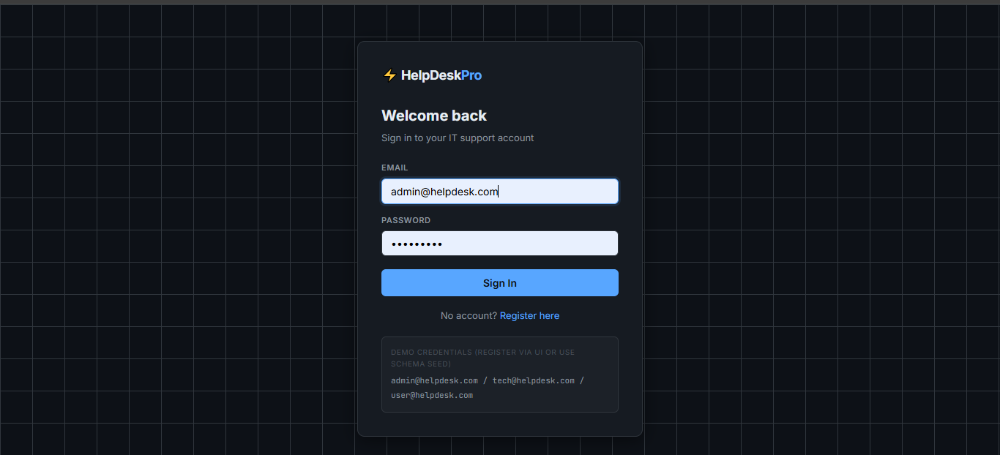
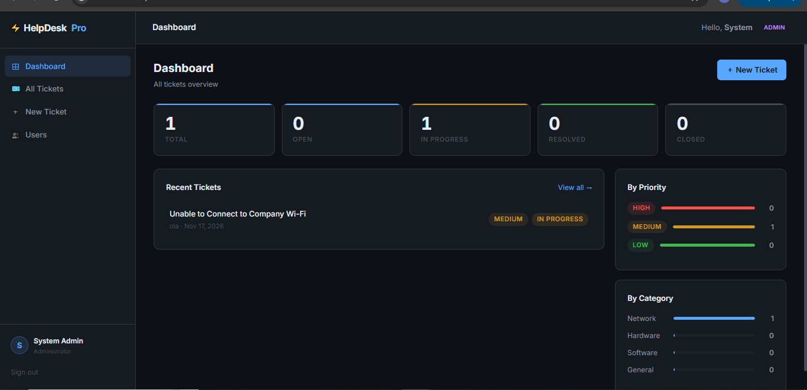
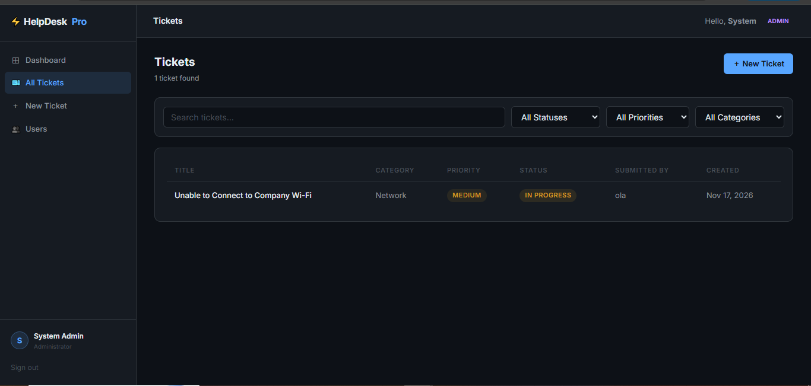
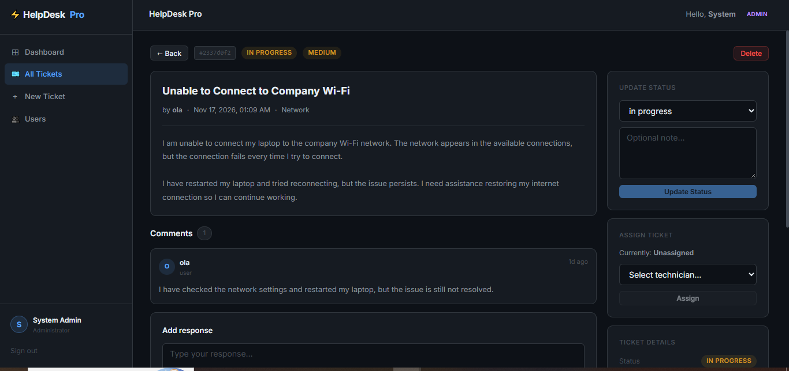
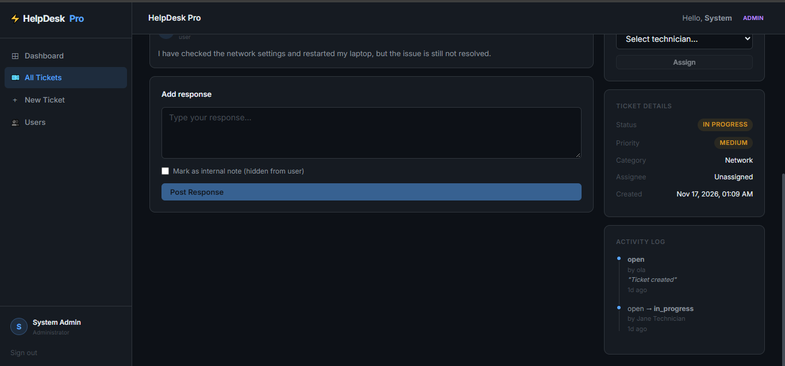

# 🎫 HelpDesk Pro — IT Ticketing System

A full-stack IT Helpdesk Ticketing System built with **React**, **Node.js/Express**, and **PostgreSQL**.

The application helps organizations manage support requests, track ticket progress, and streamline communication between administrators, technicians, and end users.

---

## ✨ Features

| Feature | Details |
|---|---|
| 🔐 Authentication | JWT login and registration with bcrypt password hashing |
| 👥 Role-Based Access | Admin, Technician, and End User roles with route protection |
| 🎫 Ticket Management | Create, view, filter, search, and paginate tickets |
| 🔄 Ticket Workflow | Open → In Progress → Resolved → Closed |
| 💬 Comments | Ticket discussions and internal staff notes |
| 📋 Audit Log | Ticket status-change history |
| 📊 Dashboard | Role-specific statistics, priority and category charts |
| 🔔 Email Notifications | Nodemailer notifications with mock mode for local development |
| 👤 User Management | Admin controls for user roles and account activation |

---

## 🛠 Tech Stack

- **Frontend:** React 18, React Router v6, Axios, CSS
- **Backend:** Node.js, Express.js, express-validator
- **Database:** PostgreSQL, pg
- **Authentication:** JWT (jsonwebtoken) and bcryptjs
- **Email:** Nodemailer

---

## 📁 Project Structure

```text
helpdesk-ticketing-system/
├── client/
│   └── src/
│       ├── components/
│       ├── context/
│       ├── pages/
│       ├── services/
│       └── utils/
├── server/
│   ├── config/
│   ├── controllers/
│   ├── middleware/
│   ├── routes/
│   └── services/
├── docs/
│   ├── screenshots/
│   │   ├── 01-login.png
│   │   ├── 02-dashboard.png
│   │   ├── 03-tickets-list.png
│   │   ├── 04-ticket-details.png
│   │   └── 05-ticket-activity-log.png
│   ├── schema.sql
│   └── api.md
├── .env.example
├── package.json
└── README.md
```

---

## 📸 Screenshots

### Login Page


### Dashboard


### All Tickets


### Ticket Details


### Ticket Activity Log


---

## 🚀 Quick Start

### Prerequisites

- Node.js >= 18
- PostgreSQL >= 14
- npm

### 1. Clone the Repository

```bash
git clone https://github.com/olahatem174/helpdesk-ticketing-system.git
cd helpdesk-ticketing-system
```

### 2. Install Dependencies

```bash
npm run install:all
```

### 3. Configure Environment Variables

Copy the example environment file to the expected local filename.

**Windows PowerShell:**

```powershell
Copy-Item .env.example env
```

**Linux / macOS:**

```bash
cp .env.example env
```

Edit `env` and configure your database credentials and JWT secret.

**Important:** Never commit your actual environment file or expose sensitive credentials.

### 4. Create and Initialize the Database

Create a PostgreSQL database named `helpdesk_db`:

```sql
CREATE DATABASE helpdesk_db;
```

Then execute the database schema:

```bash
psql -U postgres -d helpdesk_db -f docs/schema.sql
```

### 5. Run the Application

```bash
npm run dev
```

The application will be available at:

| Service | URL |
|---|---|
| Frontend | http://localhost:3000 |
| Backend API | http://localhost:5000/api |

---

## 📡 API Overview

See [docs/api.md](docs/api.md) for the full API endpoint reference.

```text
POST   /api/auth/register
POST   /api/auth/login
GET    /api/auth/me

GET    /api/tickets
POST   /api/tickets
GET    /api/tickets/:id
PUT    /api/tickets/:id
PUT    /api/tickets/:id/status
PUT    /api/tickets/:id/assign
DELETE /api/tickets/:id

GET    /api/tickets/:id/comments
POST   /api/tickets/:id/comments

GET    /api/users
PUT    /api/users/:id
DELETE /api/users/:id

GET    /api/dashboard
GET    /api/categories
```

---

## 🔮 Future Improvements

- [ ] WebSocket real-time updates
- [ ] File attachment uploads
- [ ] SLA tracking and breach alerts
- [ ] Slack / Microsoft Teams integration
- [ ] Two-factor authentication (2FA)

---

## 📄 License

MIT License